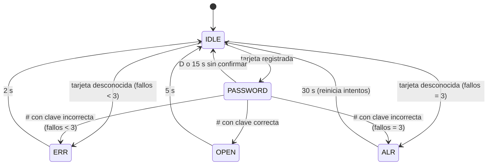

# Sistema Embebido para Control de Acceso y Monitoreo de Confort Térmico

Proyecto final de **Arquitectura Computacional** — Universidad del Cauca,
Facultad de Ingeniería Electrónica y Telecomunicaciones, Programa de
Ingeniería de Sistemas, 2026.

| Rol | Nombre |
|-----|--------|
| Integrante | Iván Alexander López Lasso |
| Integrante | Martín Silva |
| Integrante | Sindy Paola Caicedo |
| Docente | Fulvio Yesid Vivas Cantero |

Plataforma: **Arduino Mega 2560 (ATmega2560)**, framework Arduino sobre
PlatformIO, simulación virtual en **Wokwi**.

---

## 1. Descripción general

El sistema controla el acceso a un recinto con **autenticación de dos
factores (2FA) secuencial** y, en paralelo, monitorea el ambiente para
calcular el confort térmico y accionar automáticamente la ventilación y
la iluminación. No usa cerradura mecánica ni servo: el acceso se
señaliza con LED y buzzer. No usa RTC: toda la temporización se basa en
`millis()` con aritmética `uint32_t` segura ante el desbordamiento.

### Objetivos

- **2FA RFID + clave:** primero una tarjeta RFID **MFRC522** registrada
  (UID de 4 o 7 bytes), luego la contraseña individual por **teclado
  matricial 4x4**, enmascarada con `*` en el LCD.
- **Usuarios persistentes:** exactamente **3 usuarios** con perfiles
  distintos, guardados en **EEPROM** con firma, versión de layout y
  **CRC-16/CCITT** (polinomio `0x1021`).
- **Seguridad:** LED rojo + buzzer ante credencial incorrecta y
  **bloqueo temporal de 30 s** tras **3 intentos fallidos**.
- **Monitoreo ambiental:** temperatura y humedad con **DHT11** (DHT22 en
  Wokwi), nivel de luz con **LDR** en `A0` y **entrada analógica
  auxiliar** en `A1`, ambas filtradas con **promedio móvil de 8
  muestras**.
- **Confort térmico:** índice **PMV de Fanger (ISO 7730)** con
  ventilación automática por histéresis (ON si `PMV > +0.5`, OFF si
  `PMV ≤ +0.2`).
- **Iluminación automática:** según el LDR con histéresis (ON si
  `LDR < 300`, OFF si `LDR > 400`).
- **Estado de puerta:** **sensor de efecto Hall** mostrado en el LCD.
- **Arquitectura cooperativa:** 8 tareas `AsyncTaskLib` y una FSM de 5
  estados con `StateMachineLib`, sin `delay()` en el flujo principal.

---

## 2. Componentes y asignación de pines

Fuente única de verdad: [`include/config.h`](include/config.h). El
cableado de [`diagram.json`](diagram.json) y
[`docs/02_pinout.md`](docs/02_pinout.md) coincide con esta tabla.

| Componente (hardware real) | Parte Wokwi | Señal | Pin Mega | Macro `config.h` |
|----------------------------|-------------|-------|----------|------------------|
| Lector RFID MFRC522 | `board-mfrc522` | SDA (SS) | 53 | `PIN_RFID_SS` |
| | | SCK / MOSI / MISO | 52 / 51 / 50 | bus SPI hardware |
| | | RST | 5 | `PIN_RFID_RST` |
| | | 3.3V / GND | 3.3V / GND | — |
| Teclado matricial 4x4 | `wokwi-membrane-keypad` | Filas R1–R4 | 30, 31, 32, 33 | `PIN_KEYPAD_ROWS` |
| | | Columnas C1–C4 | 34, 35, 36, 37 | `PIN_KEYPAD_COLS` |
| LCD 16x2 (modo 4 bits) | `wokwi-lcd1602` | RS / E | 8 / 9 | `PIN_LCD_RS`, `PIN_LCD_EN` |
| | | D4 / D5 / D6 / D7 | 10 / 11 / 12 / 13 | `PIN_LCD_D4`…`PIN_LCD_D7` |
| | | RW, V0, K / VDD, A (220 Ω) | GND / 5V | — |
| Sensor Hall (puerta) | `wokwi-slide-switch` | Salida (común) | 40 | `PIN_HALL_DOOR` |
| DHT11 (DHT22 en Wokwi) | `wokwi-dht22` | DATA | 22 | `PIN_DHT` |
| Sensor de luz LDR | `wokwi-photoresistor-sensor` | AO | A0 | `PIN_LDR` |
| Sensor analógico auxiliar | `wokwi-potentiometer` | SIG | A1 | `PIN_ANALOG_AUX` |
| LED rojo + 220 Ω | `wokwi-led` (rojo) | Ánodo | 6 | `PIN_LED_RED` |
| LED verde + 220 Ω | `wokwi-led` (verde) | Ánodo | 7 | `PIN_LED_GREEN` |
| Relé de ventilación | `wokwi-led` (azul) + 220 Ω | IN | 44 | `PIN_FAN` |
| Relé/LED de iluminación | `wokwi-led` (amarillo) + 220 Ω | IN | 46 | `PIN_LIGHT_OUT` |
| Buzzer pasivo | `wokwi-buzzer` | + | 48 | `PIN_BUZZER` |

Notas:

- **Hall:** entrada con `INPUT_PULLUP` y anti-rebote de 50 ms. `LOW` =
  imán presente = puerta cerrada (`CER`); `HIGH` = abierta (`ABI`). En
  Wokwi el lado `1` del slide switch va a GND.
- **Relés:** su nivel activo lo define `RELAY_ACTIVE_LEVEL` (por defecto
  `HIGH`); para módulos activos en bajo se cambia a `LOW`.
- **Buzzer:** `tone()` a 2 kHz (acceso) y 400 Hz (error/alarma).
- **Teclado:** `1 2 3 A / 4 5 6 B / 7 8 9 C / * 0 # D`. `#` confirma, `*`
  borra el último dígito y `D` cancela.
- **Libres:** UART0 (0, 1) para el monitor serie a 9600 baudios, e I2C
  (20, 21) porque no hay RTC.

---

## 3. Arquitectura del software

### 3.1 Módulos

| Archivo | Responsabilidad |
|---------|-----------------|
| `include/config.h` | Pines, tiempos, umbrales PMV/LDR, parámetros EEPROM y periodos de tareas |
| `include/arduino.h` | Adaptador `#include_next <Arduino.h>`: `StateMachineLib` incluye `arduino.h` en minúsculas, lo que falla en sistemas sensibles a mayúsculas |
| `src/main.cpp` | Instancia los módulos, define las 8 `AsyncTask` y las despacha desde `loop()` |
| `src/AccessFSM.h/.cpp` | FSM 2FA sobre `StateMachineLib` (5 estados, 10 transiciones) |
| `src/AuthManager.h/.cpp` | Valida tarjeta y luego la contraseña del usuario de esa tarjeta |
| `src/UserManager.h/.cpp` | 3 usuarios (`UserRecord`: UID, perfil, clave), búsqueda por UID y valores por defecto |
| `src/NvmStorage.h/.cpp` | Imagen EEPROM: `magic` `0xAC55`, versión `2`, longitud y CRC-16/CCITT |
| `src/RfidUid.h` | `RfidUid { bytes[7]; size; }`; solo acepta 4 o 7 bytes y compara con relleno `0x00` |
| `src/RfidReader.h/.cpp` | Polling del MFRC522 por SPI; descarta UID de longitud no soportada |
| `src/KeypadReader.h/.cpp` | Escaneo matricial 4x4 con anti-rebote por `millis()` |
| `src/DoorSensor.h/.cpp` | Lectura filtrada del sensor Hall |
| `src/EnvSensors.h/.cpp` | DHT, LDR (`A0`) y A1 con promedio móvil `Average` de 8 muestras → `EnvSnapshot` |
| `src/ComfortController.h/.cpp` | PMV/PPD de Fanger, histéresis de ventilación e iluminación → `ComfortAction` |
| `src/Actuators.h/.cpp` | LED verde/rojo, patrones no bloqueantes del buzzer y relés |
| `src/DisplayUI.h/.cpp` | Pantallas del LCD 16x2 por estado |
| `lib/Average/` | Librería local de promedios ([MajenkoLibraries/Average](https://github.com/MajenkoLibraries/Average)) |

Los módulos se comunican mediante interfaces públicas y snapshots
(`EnvSnapshot`, `ComfortAction`, `UiSnapshot`) que pasan las tareas, sin
variables globales compartidas entre módulos.

### 3.2 FSM de acceso 2FA (`StateMachineLib`)



| Estado | LCD (línea 1) | Salidas |
|--------|---------------|---------|
| `IDLE` | `IDLE  Puerta:CER/ABI` | Señales apagadas; línea 2 con T, HR y PMV |
| `PASSWORD` | `PASSWORD` + segundos restantes | Línea 2: `Clave:****` |
| `OPEN` | `OPEN  Bienvenido` | LED verde + tono de 2 kHz (1 s); perfil y cuenta regresiva |
| `ERR` | `ERR  Intento n/3` | LED rojo + tono de 400 Hz (200 ms) |
| `ALR` | `ALR   BLOQUEADO` | LED rojo + buzzer intermitente (500 ms); `Espere NNs` |

Las tarjetas solo se procesan en `IDLE` y las teclas solo en `PASSWORD`,
así que durante el bloqueo no se aceptan credenciales. Los tiempos son
`OPEN_DURATION_MS`, `ERR_DISPLAY_MS`, `LOCKOUT_DURATION_MS` y
`PASSWORD_TIMEOUT_MS`.

### 3.3 Tareas asíncronas cooperativas (`AsyncTaskLib`)

| Tarea | Periodo | Responsabilidad |
|-------|---------|-----------------|
| `taskFsm` | 20 ms | Evaluar transiciones de `AccessFSM` |
| `taskKeypad` | 30 ms | Escanear el teclado y entregar teclas a la FSM |
| `taskDoor` | 50 ms | Leer el sensor Hall |
| `taskActuators` | 50 ms | Aplicar órdenes de ventilación/iluminación y patrones del buzzer |
| `taskRfid` | 100 ms | Leer tarjetas e imprimir `UID: .. (N bytes)` por Serial |
| `taskLcd` | 250 ms | Refrescar el LCD 16x2 |
| `taskEnv` | 2000 ms | Muestrear DHT/LDR/A1 y recalcular PMV y acciones de confort |
| `taskTelemetry` | 2000 ms | Imprimir la línea `[ENV]` por Serial |

Todas se crean con `AutoReset = true` y `loop()` solo llama `Update()`
de cada una. La lógica de la aplicación mide intervalos con
`uint32_t elapsed = millis() - inicio;`, correcto también cuando
`millis()` se desborda (cada ~49.7 días).

### 3.4 Modelo de confort (PMV, ISO 7730)

Entradas medidas: `Ta` y `HR` del DHT. Supuestos fijos: `Tr = Ta`,
`v = 0.1 m/s`, `M = 1.2 met`, `Icl = 0.5 clo`, `W = 0`. La temperatura de
la ropa se resuelve por iteración y también se calcula el PPD. Contra el
Anexo D de ISO 7730: 22 °C / 60 % → PMV −0.752 (norma −0.75) y
27 °C / 60 % → 0.765 (norma 0.77). Detalle en
[`docs/01_arquitectura_y_requisitos.md`](docs/01_arquitectura_y_requisitos.md) §8.

### 3.5 Usuarios por defecto

| Perfil | UID hardware real | UID en `env:wokwi` | Tarjeta Wokwi | Clave |
|--------|-------------------|--------------------|---------------|-------|
| Seguridad | `01:02:03:04` | `01:02:03:04` | Blue Card | `1234` |
| Operario | `11:22:33:44` | `11:22:33:44` | Green Card | `5678` |
| Gerente | `04:11:22:33:44:55:66` (7 bytes) | `04:11:22:33` | NFC Tag | `2468` |

El `board-mfrc522` de Wokwi entrega solo los 4 primeros bytes del NFC
Tag, por eso `env:wokwi` define `WOKWI_SIMULATION=1` (ver
[H-11](docs/03_hallazgos.md)). Red Card y Yellow Card no están
registradas. Para el laboratorio se reemplazan los UID por los de las
tarjetas reales, que el firmware imprime por Serial, y se incrementa
`EEPROM_LAYOUT_VERSION`.

---

## 4. Tecnologías y librerías

| Elemento | Versión / origen |
|----------|------------------|
| PlatformIO, `platform = atmelavr`, `board = megaatmega2560` | Framework Arduino |
| `miguelbalboa/MFRC522` | `^1.4.9` |
| `adafruit/DHT sensor library` | `^1.4.6` |
| `arduino-libraries/LiquidCrystal` | `^1.0.7` |
| `luisllamasbinaburo/StateMachineLib` | `^1.0.0` |
| `luisllamasbinaburo/AsyncTaskLib` | `^1.0.0` |
| `Average` | Local en `lib/Average/` |
| Doxygen | Documentación del código (`Doxyfile`) |
| Wokwi | Simulación (`wokwi.toml`, `diagram.json`) |

El teclado no usa `chris--a/Keypad`: el escaneo está implementado en
`KeypadReader`.

### Entornos de compilación (`platformio.ini`)

| Entorno | Uso | Diferencias |
|---------|-----|-------------|
| `megaatmega2560` | Placa física | `DHT_TYPE=DHT11`, LDR con mayor ADC = más luz, Gerente con UID de 7 bytes |
| `wokwi` | Simulación | Hereda del anterior y agrega `-D DHT_TYPE=DHT22 -D LDR_ADC_RISES_WITH_DARK=1 -D WOKWI_SIMULATION=1` |

---

## 5. Compilación, carga y documentación

Requisitos: [PlatformIO Core](https://platformio.org/install/cli) (o la
extensión de VS Code), Doxygen y, para simular, la extensión **Wokwi
Simulator** de VS Code.

```bash
# Simulación en Wokwi (genera .pio/build/wokwi/firmware.hex/.elf)
pio run -e wokwi
#   VS Code: "Wokwi: Start Simulator" (lee wokwi.toml y diagram.json)

# Placa física Arduino Mega 2560
pio run -e megaatmega2560
pio run -e megaatmega2560 -t upload
pio device monitor -b 9600

# Documentación HTML del código (salida en docs/html/)
doxygen Doxyfile
```

Los tres comandos de compilación y documentación terminan con
**0 errores y 0 advertencias**.

---

## 6. Pruebas funcionales en Wokwi (9/9 aprobadas)

| # | Prueba | Procedimiento | Resultado esperado y obtenido |
|---|--------|---------------|-------------------------------|
| 1 | 2FA correcta | Blue Card + `1234#` | Serial `UID: 01 02 03 04 (4 bytes)`; `OPEN`, LED verde 5 s + tono de 1 s, vuelve a `IDLE` |
| 2 | Tarjeta NFC (Gerente) | NFC Tag + `2468#` | Serial `UID: 04 11 22 33 (4 bytes)`; `OPEN` con perfil `GERENTE` |
| 3 | Tarjeta desconocida | Red o Yellow Card | `ERR  Intento 1/3`, LED rojo + tono |
| 4 | Clave incorrecta | Tarjeta válida + clave errónea o de otro usuario | `ERR`, intento +1, vuelve a `IDLE` |
| 5 | Bloqueo | 3 fallos consecutivos | `ALR   BLOQUEADO`, LED rojo + buzzer intermitente 30 s; credenciales ignoradas |
| 6 | Enmascarado y cancelación | Digitar dígitos, `*`, `D` o esperar 15 s | Solo `*` en el LCD; `*` borra, `D`/timeout regresan a `IDLE` |
| 7 | Sensor Hall | Mover el slide switch | LCD alterna `Puerta:CER` / `Puerta:ABI` |
| 8 | Confort e iluminación | Variar T/HR del DHT22 y la luz del LDR | PMV coherente; LED azul (44) ON con `PMV > 0.5` y OFF con `≤ 0.2`; LED amarillo (46) con histéresis 300/400 |
| 9 | Telemetría Serial | Observar el monitor y mover el potenciómetro | Línea cada 2000 ms; `A1` converge gradualmente por el promedio de 8 muestras |

Ejemplo de telemetría:

```text
[ENV] T=24.0C H=50% PMV=-0.20 LDR=512 A1=512 (2.50V) Puerta=CER
```

`A1` es el promedio de las últimas 8 muestras, tomadas cada 2000 ms
(ventana de ~16 s). El voltaje se calcula como `A1 × 5.0 / 1023`.

### EEPROM: simulación vs. hardware real

- **Wokwi:** la EEPROM empieza vacía en cada simulación. La firma o el
  CRC no validan, el firmware imprime
  `EEPROM invalida: usuarios por defecto restaurados` y graba los 3
  usuarios por defecto. Por eso el mensaje aparece en cada arranque.
- **Hardware real:** el mensaje aparece solo en el primer arranque, o
  cuando cambia `EEPROM_LAYOUT_VERSION` o la imagen se corrompe. En los
  reinicios siguientes los usuarios se cargan de la EEPROM sin
  reescribirla.

El backlog completo de pruebas (15 casos) está en
[`docs/01_arquitectura_y_requisitos.md`](docs/01_arquitectura_y_requisitos.md) §9.

---

## 7. Estructura del repositorio

```text
Arquitectura-computacional/
├── include/
│   ├── config.h              # Pines, tiempos y parámetros del sistema
│   └── arduino.h             # Adaptador de mayúsculas para StateMachineLib
├── src/
│   ├── main.cpp              # Módulos + 8 AsyncTask
│   ├── AccessFSM.h/.cpp      # FSM 2FA (StateMachineLib)
│   ├── AuthManager.h/.cpp    # Validación tarjeta -> clave
│   ├── UserManager.h/.cpp    # 3 usuarios y valores por defecto
│   ├── NvmStorage.h/.cpp     # EEPROM con versión y CRC-16/CCITT
│   ├── RfidUid.h             # UID de 4/7 bytes
│   ├── RfidReader.h/.cpp     # Driver MFRC522
│   ├── KeypadReader.h/.cpp   # Teclado 4x4
│   ├── DoorSensor.h/.cpp     # Sensor Hall
│   ├── EnvSensors.h/.cpp     # DHT + LDR + A1 filtrados
│   ├── ComfortController.h/.cpp # PMV/PPD e histéresis
│   ├── Actuators.h/.cpp      # LEDs, buzzer y relés
│   └── DisplayUI.h/.cpp      # Pantallas del LCD 16x2
├── lib/
│   └── Average/              # Librería local de promedio móvil
├── docs/
│   ├── 01_arquitectura_y_requisitos.md
│   ├── 02_pinout.md
│   └── 03_hallazgos.md       # H-01 … H-11
├── diagram.json              # Circuito de simulación Wokwi
├── wokwi.toml                # Firmware de .pio/build/wokwi/
├── platformio.ini            # Entornos megaatmega2560 y wokwi
├── Doxyfile                  # Configuración de Doxygen (salida docs/html/)
└── README.md
```

`.pio/` y `docs/html/` son artefactos generados y no se versionan.
